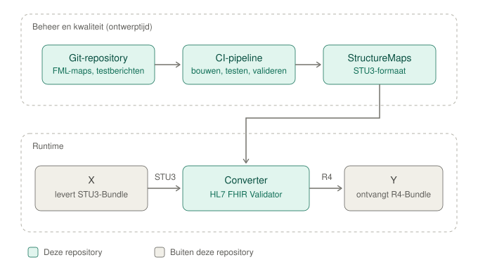

# FHIR-conversie

Converteert FHIR-resources tussen FHIR-versies, met mappings in de [FHIR Mapping Language](https://hl7.org/fhir/R4/mapping-language.html) (FML). Uitgevoerd door de [HL7 FHIR Validator](https://github.com/hapifhir/org.hl7.fhir.core).

Naast de FHIR-versie zetten de mappings waar nodig ook het profiel om, bijvoorbeeld tussen de Nictiz-profielen op zib2020 (R4) en die op zib2017 (STU3). De repository is opgezet voor meerdere conversierichtingen; elke richting staat op zichzelf.

> **Status:** concept. De eerste richting is R4 → STU3, voor de gegevensdienst LaboratoryResults.

## Conversierichtingen

| Richting | Map | Gegevensdiensten | Status |
| --- | --- | --- | --- |
| R4 → STU3 | [`conversies/r4-stu3/`](conversies/r4-stu3/) | LaboratoryResults | in opzet |

Een nieuwe richting is een nieuwe map `conversies/<bron>-<doel>/` met dezelfde indeling. De scripts, de documentatie in `docs/` en de werkwijze zijn gedeeld.

## Ontwerp



**Runtime.** De converter is een black box: een Bundle in de bronversie erin, een Bundle in de doelversie eruit, in één aanroep. De `map`-parameter kiest de richting.

```text
POST http://<host>:8090/transform?map=http://medmij.nl/fhir/StructureMap/r4-stu3-Bundle
Content-Type: application/fhir+json   (of application/fhir+xml)
Accept:       application/fhir+json

Body:     Bundle in de bronversie
Antwoord: Bundle in de doelversie
```

Resource-id's, `fullUrl`'s en `search.mode` blijven behouden, zodat referenties binnen de Bundle geldig blijven. Dezelfde conversie kan ook als command line-aanroep, met bestanden.

**Mappings in drie lagen**, per richting:

| Laag | Map | Doet |
| --- | --- | --- |
| Bundle | `maps/Bundle.map` | Neemt Bundle-velden over en stuurt elke entry naar de juiste map: op resourcetype, en waar één resourcetype meerdere profielen kent (zoals Observation) ook op profiel. |
| Resource | `maps/resources/<Resourcetype>/<Map>.map` | Eén map per resourcetype zonder profiel, of per profiel: de versieconversie plus profiel-URL's, extensies en profielspecifieke regels. |
| Datatypes | `maps/datatypes/<Datatype>.map` | Gedeelde regels, bijvoorbeeld voor codesystemen, namen, adressen en identifiers. Geïmporteerd door de resource-maps. |

Voor profielen op basis van zibs staat wat er inhoudelijk verandert tussen zib2017 en zib2020 in de translatietabellen van Nictiz: [Zibtranslate](https://github.com/Nictiz/Zibtranslate), in beide richtingen.

**Context van de Validator.** De Validator draait in de FHIR-versie van de bron, zodat de invoer als echte bronversie wordt gelezen. De doeltypes komen uit het HL7-package `hl7.fhir.xver.<bron>`, met versienummer in de URL (bijvoorbeeld `http://hl7.org/fhir/3.0/StructureDefinition/Observation`). Zie [B05](docs/beslissingen.md#b05).

**Documentatie vóór code.** Per map beschrijft een document in `conversies/<richting>/mappings/` de regels en keuzes, vóór de FML wordt geschreven ([B08](docs/beslissingen.md#b08)). Ontwerpkeuzes staan in [docs/beslissingen.md](docs/beslissingen.md).

## Repository-indeling

```text
conversies/
  r4-stu3/                 één map per conversierichting: <bron>-<doel>
    README.md              richting, profielen, gegevensdiensten
    maps/
      Bundle.map           routeert entries naar de resource-maps
      resources/           per resourcetype een map, met één map per profiel
      datatypes/           gedeelde regels (Coding.map, HumanName.map, ...)
    mappings/              per map de regels en keuzes (.md)
    tests/
      <gegevensdienst>/    bijv. LaboratoryResults/
        bron/              ongewijzigd uitgangsmateriaal
        input/             testberichten in de bronversie
        expected/          verwachte uitvoer in de doelversie
docs/
  beslissingen.md          ontwerpbeslissingen (B01, B02, ...)
  architectuur.svg
scripts/                   bouwen, testen en valideren, met de richting als parameter
docker/                    container voor de converter in servermodus
.github/workflows/         CI: bouwen, testen, valideren bij elke wijziging
build/<richting>/          gegenereerde StructureMaps (niet in Git)
```

## Naamgeving en canonicals

Volgens [B03](docs/beslissingen.md#b03). `<richting>` is `<bron>-<doel>` met de korte namen van de FHIR-versies: `stu3`, `r4`, `r4b`, `r5`.

| Wat | Patroon | Voorbeeld |
| --- | --- | --- |
| Map (bestand) | Naar het bronprofiel zonder voorvoegsel (`nl-core-`, `zib-`), of naar het resourcetype als er geen profiel is | `LaboratoryTestResult.map` |
| Canonical | `http://medmij.nl/fhir/StructureMap/<richting>-<map>` | `http://medmij.nl/fhir/StructureMap/r4-stu3-LaboratoryTestResult` |
| `StructureMap.name` en groepen | `<Richting><Map>` in PascalCase, zonder streepjes of punten | `R4Stu3LaboratoryTestResult` |
| Andere artefacten, zoals ConceptMaps | `http://medmij.nl/fhir/<Resourcetype>/<richting>-<naam>` | `http://medmij.nl/fhir/ConceptMap/r4-stu3-InterpretatieVlaggen` |
| Versie | In `StructureMap.version`, niet in de URL | `http://medmij.nl/fhir/StructureMap/r4-stu3-Bundle\|0.1.0` |

## Gebruik

### Vereisten

- Java 17 of hoger
- Ongeveer 1 GB geheugen voor de Validator. Begrens de heap met `-Xmx1536m`; zonder die grens kan Java bij weinig vrij geheugen vastlopen. Meldt Java dan nog `insufficient memory` (`Chunk::new`), voeg `-XX:TieredStopAtLevel=1` toe: dat beperkt het geheugen van de JIT-compiler.
- Netwerktoegang tot `packages.fhir.org` bij de eerste start. Daarna komen de packages uit de lokale cache (`~/.fhir/packages`).
- Voor bouwen en converteren op de command line: een terminologieserver (standaard `tx.fhir.org`). `transform` weigert te starten zonder. De HTTP-service heeft er geen nodig (`-tx n/a`, [B06](docs/beslissingen.md#b06)).

Gebruik de meest recente versie van de Validator. Draai na een update de testset.

```bash
curl -L -o validator_cli.jar \
  https://github.com/hapifhir/org.hl7.fhir.core/releases/latest/download/validator_cli.jar
```

### Maps bouwen

Voorbeeld voor R4 → STU3. Een R4-context kan FML direct lezen; compileren is dan de enige stap.

```bash
R=r4-stu3                                        # richting
PREFIX=http://medmij.nl/fhir/StructureMap/$R-    # canonical = voorvoegsel + mapnaam
V="java -Xmx1536m -jar validator_cli.jar"

for f in $(find conversies/$R/maps -name '*.map'); do
  m=$(basename "$f" .map)
  $V compile $PREFIX$m -version 4.0 -ig "$f" -output build/$R/$m.json
done
```

Bij `compile` is het eerste argument de canonical van de map; het `.map`-bestand gaat mee via `-ig`. Een richting met STU3 als bron vraagt een extra stap, omdat een STU3-context geen FML kan lezen ([B05](docs/beslissingen.md#b05)).

### Converteren als bestand

```bash
$V transform ${PREFIX}Bundle conversies/$R/tests/LaboratoryResults/input/bundle.json \
   -version 4.0 -ig hl7.fhir.xver.r4#1.2.0 -ig build/$R \
   -output bundle-stu3.json
```

### Converteren als HTTP-service

```bash
$V server 8090 -version 4.0 -tx n/a -ig hl7.fhir.xver.r4#1.2.0 -ig build/$R
```

- `-tx n/a` maakt de service onafhankelijk van een terminologieserver. Zonder deze optie start de service niet als `tx.fhir.org` onbereikbaar is.
- De service luistert standaard alleen op `localhost`. Voor toegang van buiten de machine, bijvoorbeeld in een container, is `-allowNetworkAccess` nodig.
- Met een warme package-cache is de service na ongeveer 10 seconden beschikbaar; de eerste start duurt langer omdat de packages dan worden gedownload. Een conversie duurt daarna minder dan 0,1 seconde per Bundle.
- Een service draait in één FHIR-versie (`-version`), dus alleen richtingen met dezelfde bronversie kunnen samen in één service. Dat is nog niet uitgeprobeerd. Na een nieuwe build de service herstarten. Stoppen kan met `POST /stop`.
- Documentatie van alle endpoints staat op `/docs` (OpenAPI: `/openapi.json`). Een aanroep zonder `map` geeft een OperationOutcome met `Missing required query parameter: map`.

## Let op

- **Niet-gemapte elementen verdwijnen zonder melding.** Dat geldt ook voor hele resources: een entry waarvoor de Bundle-map geen regel heeft, komt terug met alleen `fullUrl` en `search`, zonder `resource`. Valideer de uitvoer altijd tegen de doelprofielen en vergelijk met `tests/<gegevensdienst>/expected/`.
- **Controleer of er uitvoer is.** `compile` en `transform` melden "Successfully compiled" of "Successfully transformed", ook als er iets misging, bijvoorbeeld als een map niet gevonden wordt. Er wordt dan geen uitvoerbestand geschreven. De echte fout staat eerder in de uitvoer (`...Failure:`).
- **De servermodus heeft geen authenticatie,** en beheerendpoints als `/stop` en `/loadIG` staan open voor iedereen die de service kan bereiken. Gebruik `-allowNetworkAccess` alleen op een afgeschermd netwerk.
- **Alleen synthetische testdata** in deze repository, geen patiëntgegevens.

## Bronnen

- [FHIR Mapping Language](https://hl7.org/fhir/R4/mapping-language.html)
- [HL7 FHIR Validator](https://github.com/hapifhir/org.hl7.fhir.core) en [Using the FHIR Validator](https://confluence.hl7.org/spaces/FHIR/pages/35718580/Using+the+FHIR+Validator). De ingebouwde hulp is actueler: `java -jar validator_cli.jar help <commando>`.
- [Nictiz STU3 zib2017](https://simplifier.net/nictizstu3-zib2017) en [Nictiz R4 zib2020](https://simplifier.net/nictiz-r4-zib2020)
- [Zibtranslate: translatiespecificaties zib2017 ↔ zib2020](https://github.com/Nictiz/Zibtranslate)
